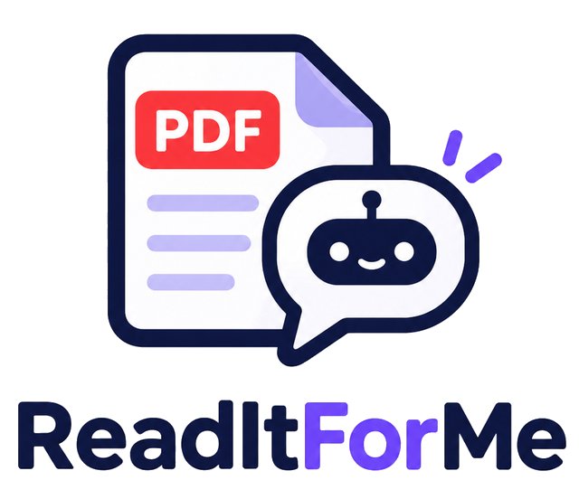
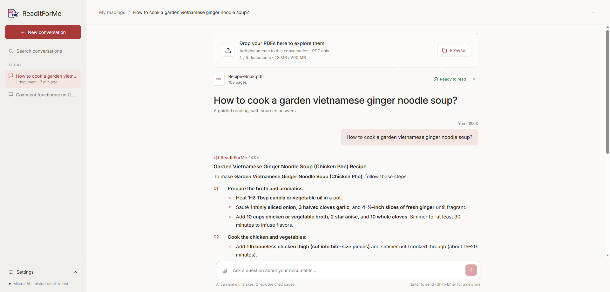
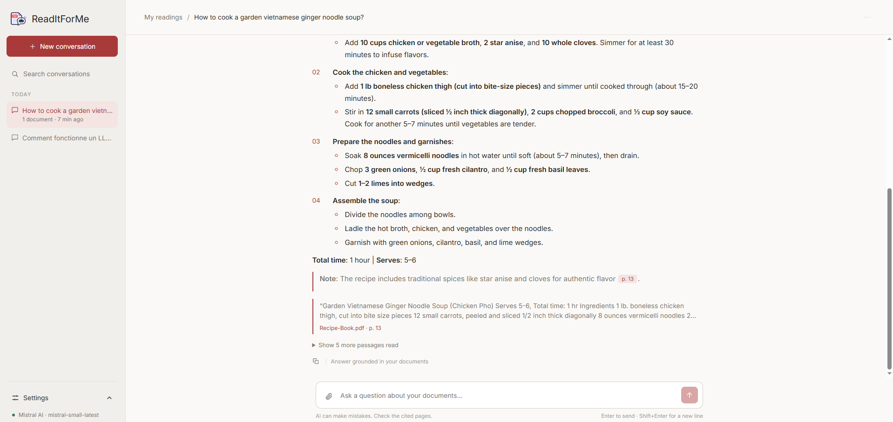
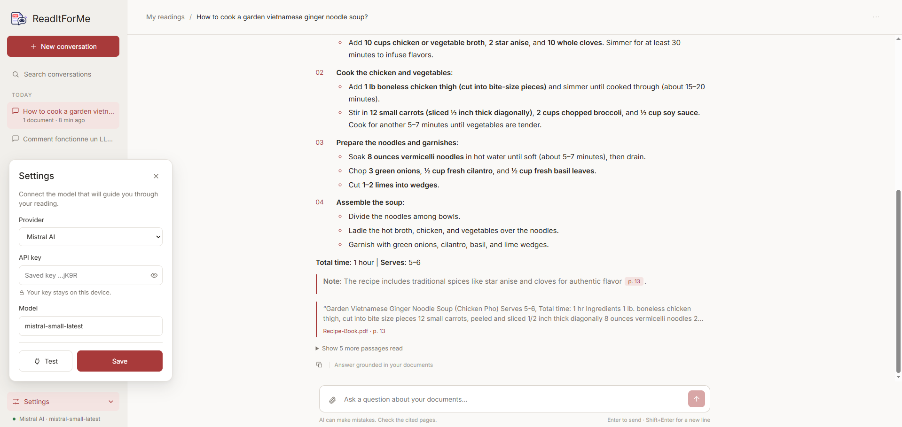

<p align="center"></p>

# ReadItForMe

A local chatbot to ask questions about your PDFs. Create conversations, drop your documents into them,
and chat with them. All it takes is an API key (OpenAI, Anthropic, Google or Mistral).

> **Just want to try it out?** Google offers a free API key for Gemini: generate one in
> [Google AI Studio](https://aistudio.google.com/apikey), then select Google in the settings.

## Screenshots

**A conversation with its documents.** Drop up to 5 PDFs into a conversation and ask your questions.



**Sourced answers.** Every answer cites the pages it relies on and shows the passages that were read.



**Settings.** Pick a provider, paste your API key and choose a model. The key stays on your computer.



▶️ [Watch the demo video](https://www.youtube.com/watch?v=bBr3PHYTrlA)

## Running the app

- **Windows**: double-click `start.bat`.
- **macOS / Linux**: `./start.sh`

That's it. On first launch, the script installs [uv](https://docs.astral.sh/uv/) if it is missing,
and uv downloads Python and the dependencies by itself. The browser then opens on
http://127.0.0.1:8000, where you only need to paste your API key in the settings.

The embedding model (multilingual, ~220 MB) is downloaded automatically on first start.
It runs locally on the CPU, with no Ollama and no GPU required.

## Where is my data?

Everything lives in `~/.readitforme` (or the folder set by `READITFORME_DATA`):
conversations (`app.db`, SQLite), vector store (`chroma/`), uploaded PDFs (`files/`),
embedding model (`models/`) and settings (`settings.json`, which holds the API key).
The key never leaves this computer, except to reach the selected provider, and is never sent back to the browser.

## Architecture

```
backend/                  FastAPI (a single process serving both the API and the UI)
  readitforme/main.py     routes: settings, conversations, documents, messages
  readitforme/llm.py      provider selection through LangChain init_chat_model
  readitforme/rag.py      PDF reading (pypdf), chunking, FastEmbed embeddings, Chroma (one collection per conversation)
  readitforme/db.py       SQLite
  readitforme/static/     compiled Angular UI (committed so users don't need Node)
frontend/                 Angular sources
```

Current limitations: text PDFs only (no OCR for scanned documents), answers are not streamed,
at most 5 PDFs and 200 MB of documents per conversation.
